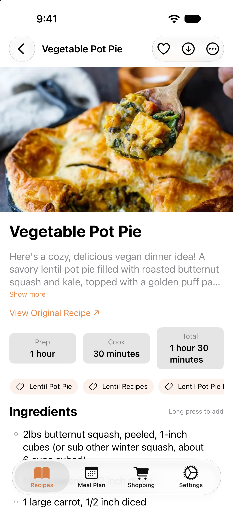
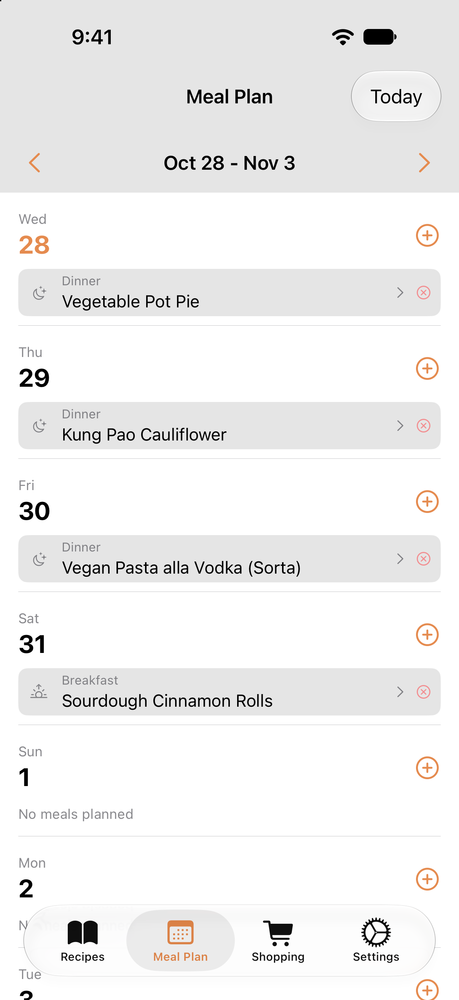

# Mealie App

Native mobile clients for [Mealie](https://mealie.io) — the self-hosted recipe manager. This repository contains two native mobile apps and a browser extension:

- **iOS** — Swift / SwiftUI (iPhone + iPad)
- **Android** — Kotlin / Jetpack Compose, MVVM (phones, foldables, and tablets)
- **Browser extension** — Recipe URL capture for Chrome-compatible browsers, Firefox, and Safari

> Previously built with [Skip Fuse](https://skip.tools) as a single cross-compiled codebase; now each platform is fully native. See `docs/ANALYSIS.md` for the rewrite rationale and feature parity checklist.

## Features

- **Recipes** — Browse, search (including by ingredient), filter by category/tag, import from URL, edit, favorite, and save for offline
- **Local mode** — Use the app without a server; recipes are parsed from the web (schema.org JSON-LD) and stored on-device
- **Recipe sync** — In server mode, all recipes sync locally for instant browsing and ingredient search
- **Meal Planning** — Weekly meal plan view with add/delete, and add-to-plan from any recipe
- **Shopping Lists** — Create lists, add items manually or from recipe ingredients (long-press), check off items, queue items offline and upload later
- **Share to import** — Share a recipe URL to the app (iOS share extension / Android share intent) to import it
- **iOS integrations** — Optional iCloud sync for local recipes and optional export of shopping ingredients to Reminders
- **Dark Mode** — System, Light, and Dark theme options
- **Adaptive layouts** — Sidebar + split view on iPad; bottom bar ↔ navigation rail and two-pane layouts on Android foldables/tablets

## Screenshots

| Recipes | Recipe Detail | Meal Plan |
|---|---|---|
|  |  |  |

## Browser Extension

The repo also ships a cross-browser extension (`extension/`) that saves recipes straight from the browser to your Mealie server: it detects schema.org Recipe JSON-LD on the page you are viewing, lights a badge on the toolbar icon, and sends the URL to Mealie's `create/url` scraper via the popup or a right-click context menu. It is a single vanilla-JS Manifest V3 codebase that loads unpacked in Chrome and Firefox, with a generated Safari wrapper app included. See [extension/README.md](extension/README.md) for installation, authentication, and development details.

## Requirements

- A running [Mealie](https://mealie.io) server (v2) — or use local mode without one
- **iOS**: Xcode 26+, iOS 17+
- **Android**: Android Studio or the command-line Android SDK with platform 35; a Gradle-compatible JDK (the project targets Java/Kotlin JVM 17). Minimum device version: Android 8.0 (API 26).
- **Extension tests**: Node.js 18+; no npm dependencies

## Getting Started

1. Clone the repository:
   ```sh
   git clone https://github.com/gannonlawlor/mealie-app.git
   cd mealie-app
   ```

2. **iOS** — build and run on the simulator:
   ```sh
   xcodebuild -project ios/Darwin/MealieApp.xcodeproj -scheme "MealieApp App" \
     -destination 'platform=iOS Simulator,name=iPhone 17 Pro' \
     build
   ```

3. **Android** — point Gradle at your SDK, then build:
   ```sh
   echo "sdk.dir=$HOME/Library/Android/sdk" > android/local.properties
   (cd android && ./gradlew :app:assembleDebug)
   ```
   The debug APK lands in `android/app/build/outputs/apk/debug/`.

4. Open the app and enter your Mealie server URL, then sign in — or choose "Use Without Server". The server must be reachable from the simulator or device; on the Android emulator, use `10.0.2.2` to reach a server running on your development machine.

For iOS development, you can also open `ios/Darwin/MealieApp.xcodeproj` in Xcode and select the **MealieApp App** scheme. Choose an installed simulator; replace the example device name in commands if needed. Running on a physical device requires configuring signing for your team.

## Running Tests

Run these commands from the repository root:

```sh
# iOS model and snapshot tests (requires an installed iOS simulator)
(cd ios && xcodebuild test -scheme mealie-app-Package \
  -destination 'platform=iOS Simulator,name=iPhone 17 Pro')

# Android unit tests, including screenshot composition smoke checks
(cd android && ./gradlew test)

# Android pixel comparison against committed screenshot goldens
(cd android && ./gradlew :app:verifyRoborazziDebug)

# Browser extension recipe detection tests (no server needed)
node --test extension/test/detect.test.mjs
```

The iOS package includes UIKit-dependent UI targets, so run its tests through
Xcode on an iOS simulator rather than `swift test`. Snapshot results depend on the
simulator OS version. Android screenshot tests run on the JVM with Robolectric;
`./gradlew test` does not compare golden images.

See the [iOS snapshot guide](ios/Tests/MealieUISnapshotTests/README.md) and
[Android screenshot guide](android/app/src/test/java/com/jackabee/mealie/screenshots/README.md)
for recording goldens and troubleshooting image differences.

## Project Structure

```
ios/
  Sources/
    MealieApp/      # App entry point, RootView
    MealieModel/    # API client, models, stores, @Observable ViewModels
    MealieUI/       # All SwiftUI views (iPhone tabs + iPad sidebar/split)
  Tests/MealieModelTests/  # XCTest unit tests
  Tests/MealieUISnapshotTests/  # snapshot tests
  Darwin/           # Xcode project, assets, ShareExtension
android/
  app/src/main/java/com/jackabee/mealie/
    data/           # models, Retrofit API, auth, stores, JSON-LD parser
    di/             # AppContainer (manual DI)
    ui/             # theme, navigation, StateFlow ViewModels, Compose screens
  app/src/test/     # JUnit unit tests
extension/          # Manifest V3 extension, Node tests, Safari wrapper
docs/               # ANALYSIS.md (feature inventory), UI_SPECS.md (screen specs)
scripts/            # release.sh (version bump + TestFlight)
```
## Releases

`scripts/release.sh [patch|minor]` runs from the repository root. It bumps both platform versions, archives the iOS app, uploads to TestFlight, commits the version files, creates a tag, and pushes the commit and tags. It requires Apple signing/upload credentials and Git push access. It does not publish an Android release.

Versions are kept together in: `ios/Darwin/MealieApp.xcconfig` (`MARKETING_VERSION`/`CURRENT_PROJECT_VERSION`, currently 1.1.18/21) and `android/app/build.gradle.kts` (`versionName`/`versionCode`, currently 1.1.18/21).

## Tech Stack

**iOS**: Swift 6, SwiftUI, `@Observable` ViewModels, URLSession, SwiftData (local recipes, optional iOS-only iCloud sync), OSLog

**Android**: Kotlin 2.1, Jetpack Compose + Material 3 (adaptive), ViewModel + StateFlow, Retrofit + OkHttp + kotlinx.serialization, Room, Coil, Navigation Compose

## License

The project README previously identified the license as MIT; this repository does not currently include a standalone license file.
