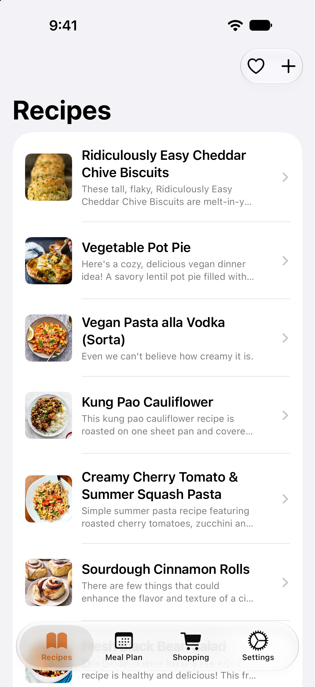
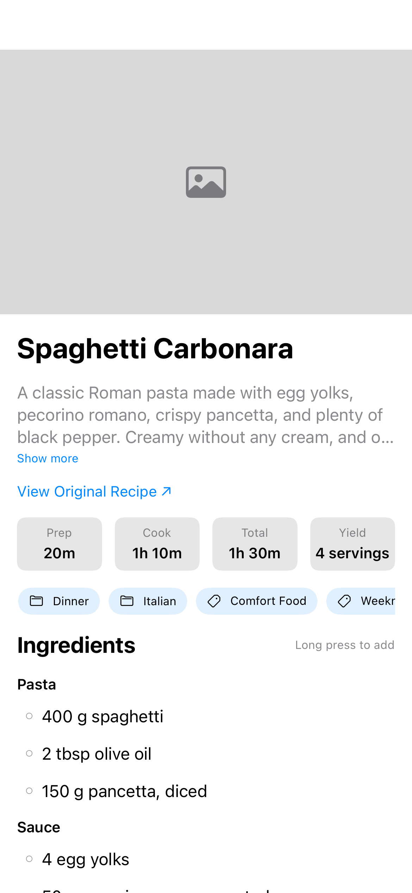
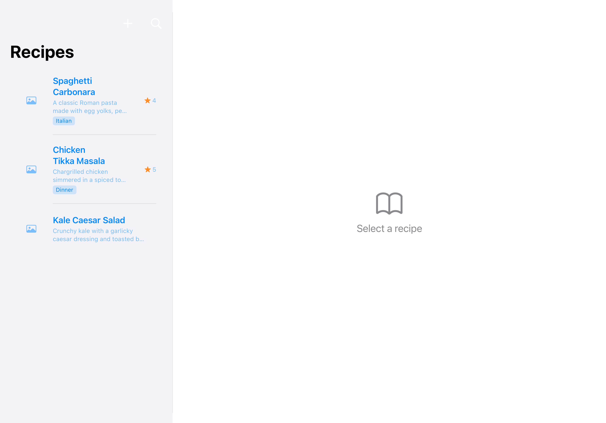
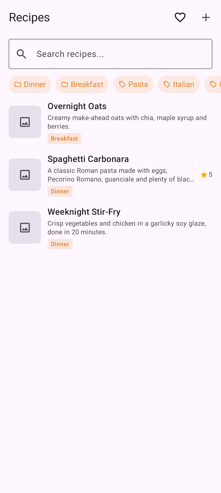
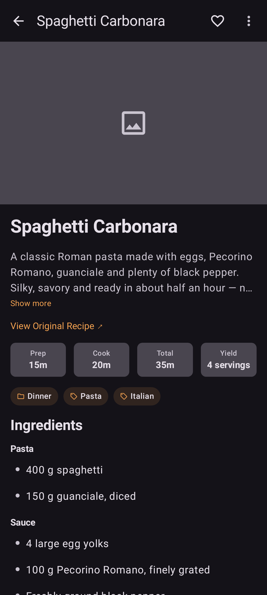
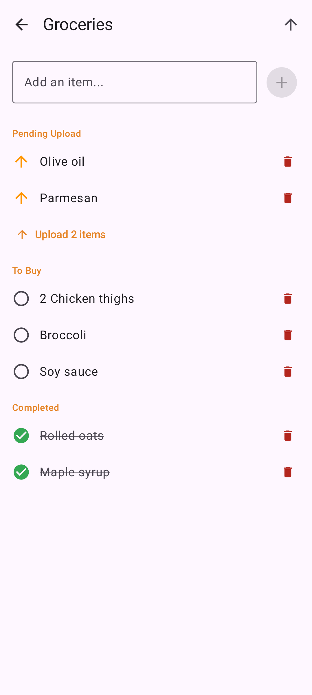
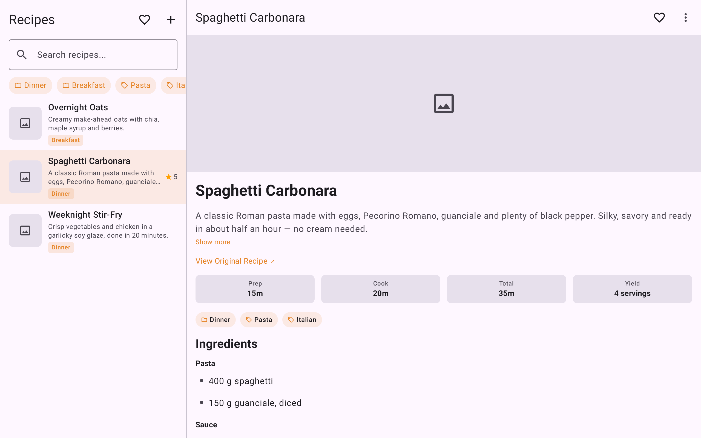

# Mealie App

Native mobile clients for [Mealie](https://mealie.io) — the self-hosted recipe manager. One repo, two fully native apps:

- **iOS** — Swift / SwiftUI (iPhone + iPad)
- **Android** — Kotlin / Jetpack Compose, MVVM (phones, foldables, and tablets)

> Previously built with [Skip Fuse](https://skip.tools) as a single cross-compiled codebase; now each platform is fully native. See `docs/ANALYSIS.md` for the rewrite rationale and feature parity checklist.

## Features

- **Recipes** — Browse, search (including by ingredient), filter by category/tag, import from URL, edit, favorite, and save for offline
- **Local mode** — Use the app without a server; recipes are parsed from the web (schema.org JSON-LD) and stored on-device
- **Recipe sync** — In server mode, all recipes sync locally for instant browsing and ingredient search
- **Meal Planning** — Weekly meal plan view with add/delete, and add-to-plan from any recipe
- **Shopping Lists** — Create lists, add items manually or from recipe ingredients (long-press), check off items, queue items offline and upload later
- **Share to import** — Share a recipe URL to the app (iOS share extension / Android share intent) to import it
- **Dark Mode** — System, Light, and Dark theme options
- **Adaptive layouts** — Sidebar + split view on iPad; bottom bar ↔ navigation rail and two-pane layouts on Android foldables/tablets

## Screenshots

### iOS

| Recipes | Recipe Detail | Meal Plan |
|---|---|---|
|  |  |  |

**iPad** — sidebar + split view:



### Android

| Recipes | Recipe Detail (dark) | Shopping List |
|---|---|---|
|  |  |  |

**Tablet / foldable** — two-pane layout:



*Screenshots are the committed golden images from the snapshot test suites (fixture data).*

## Browser Extension

The repo also ships a cross-browser extension (`extension/`) that saves recipes straight from the browser to your Mealie server: it detects schema.org Recipe JSON-LD on the page you are viewing, lights a badge on the toolbar icon, and sends the URL to Mealie's `create/url` scraper via the popup or a right-click context menu. It is a single vanilla-JS Manifest V3 codebase that loads unpacked in Chrome and Firefox, with a generated Safari wrapper app included. See [extension/README.md](extension/README.md) for installation, authentication, and development details.

## Requirements

- A running [Mealie](https://mealie.io) server (v2) — or use local mode without one
- **iOS**: Xcode 26+, iOS 17+
- **Android**: JDK 21 (Java 17 toolchain, `compileOptions`/`jvmTarget`), Android SDK (platform 35, build-tools 35.0.0)

## Getting Started

1. Clone the repository:
   ```sh
   git clone https://github.com/gannonlawlor/mealie-app.git
   cd mealie-app
   ```

2. **iOS** — build and run on the simulator:
   ```sh
   xcodebuild -project ios/Darwin/MealieApp.xcodeproj -scheme "MealieApp App" \
     -destination 'platform=iOS Simulator,name=iPhone 17 Pro' \
     build
   ```

3. **Android** — point Gradle at your SDK, then build:
   ```sh
   echo "sdk.dir=$HOME/Library/Android/sdk" > android/local.properties
   cd android && ./gradlew assembleDebug
   ```
   The debug APK lands in `android/app/build/outputs/apk/debug/`.

4. Open the app and enter your Mealie server URL to connect — or choose "Use Without Server".

## Running Tests

```sh
# iOS (must run on a simulator; `swift test` won't work — MealieUI needs UIKit)
cd ios && xcodebuild test -scheme mealie-app-Package \
  -destination 'platform=iOS Simulator,name=iPhone 17 Pro'

# Android
cd android && ./gradlew test
```

## Project Structure

```
ios/
  Sources/
    MealieApp/      # App entry point, RootView
    MealieModel/    # API client, models, stores, @Observable ViewModels
    MealieUI/       # All SwiftUI views (iPhone tabs + iPad sidebar/split)
  Tests/MealieModelTests/  # XCTest unit tests
  Tests/MealieUISnapshotTests/  # snapshot tests
  Darwin/           # Xcode project, assets, ShareExtension
android/
  app/src/main/java/com/jackabee/mealie/
    data/           # models, Retrofit API, auth, stores, JSON-LD parser
    di/             # AppContainer (manual DI)
    ui/             # theme, navigation, StateFlow ViewModels, Compose screens
  app/src/test/     # JUnit unit tests
docs/               # ANALYSIS.md (feature inventory), UI_SPECS.md (screen specs)
scripts/            # release.sh (version bump + TestFlight)
```
Versions are bumped together: `ios/Darwin/MealieApp.xcconfig` (`MARKETING_VERSION`/`CURRENT_PROJECT_VERSION`, currently 1.1.18/21) and `android/app/build.gradle.kts` (`versionName`/`versionCode`, currently 1.1.18/21).

## Tech Stack

**iOS**: Swift 6, SwiftUI, `@Observable` ViewModels, URLSession, SwiftData (local recipes, optional iOS-only iCloud sync), OSLog

**Android**: Kotlin 2.1, Jetpack Compose + Material 3 (adaptive), ViewModel + StateFlow, Retrofit + OkHttp + kotlinx.serialization, Room, Coil, Navigation Compose

## License

MIT
